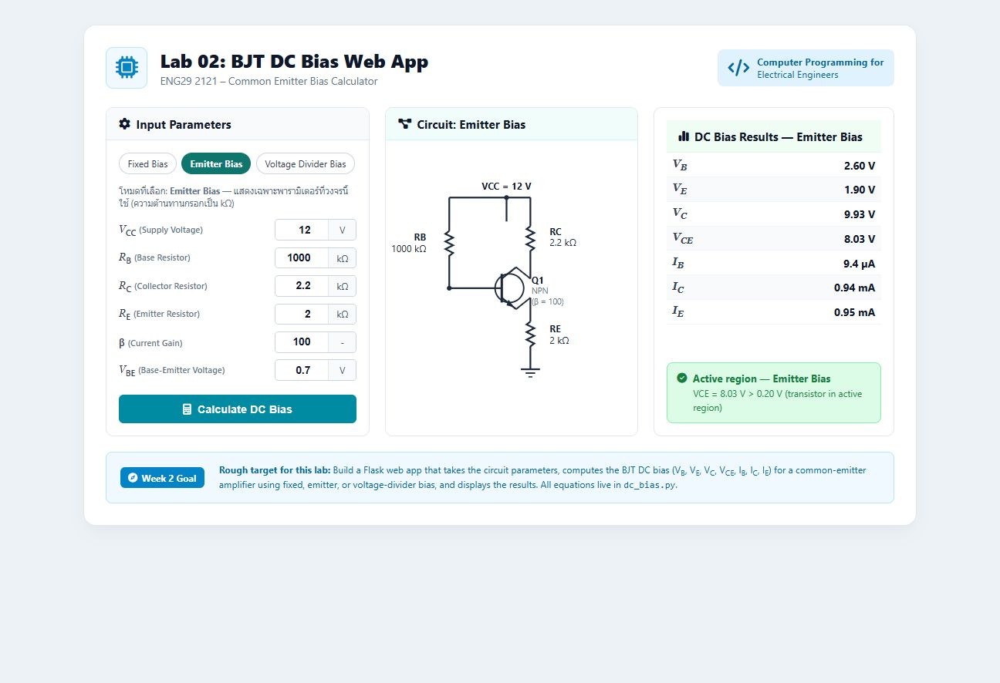

# บันทึกผลตรวจสอบ (Validation) — BJT DC Bias Web App

- วันที่ตรวจ: 2026-11-17
- URL: `http://127.0.0.1:5000`
- Flask dev server: PID 8088
- App commit: `6f28b26` — **ไม่มีการแก้ไฟล์โปรแกรมในรอบนี้** (`git diff` ว่าง; ไฟล์ที่เพิ่มมีเฉพาะเอกสารชุดนี้)
- ค่าคาดหมายอ้างอิงจากตารางใบงาน A1–A5 เท่านั้น (ไม่ได้ใช้ค่าจากโค้ดหรือ API เป็นเกณฑ์)

## 0. วิธีตรวจและข้อจำกัดของเครื่องมือ

| รายการ | สถานะ |
|---|---|
| **Playwright MCP** (`browser_navigate`, `browser_snapshot`, …) | **NOT RUN** — เครื่องนี้ยังไม่มี Node.js/npx และยังไม่มี `opencode.json`; MCP จะโหลดได้หลังติดตั้ง Node + ตั้งค่า + ปิด–เปิด OpenCode ใหม่เท่านั้น |
| **OpenCode Browser tool** (เบราว์เซอร์ Chrome จริงในแอป) | **RUN** — ใช้ `tabs.open`/`navigate`, `evaluate` (อ่าน DOM), คลิกปุ่ม Calculate ในหน้าเว็บ, `wait` จนข้อความผลลัพธ์ของโหมดนั้นปรากฏ, `network.list` อ่าน HTTP status |
| skill `browser-acceptance-check` | ไม่มีในเครื่อง (ค้นทั้ง global skills และโปรเจกต์แล้ว) จึงโหลดไม่ได้ |

**ข้อจำกัดที่พบระหว่างรัน (บันทึกตามจริง):**

1. `browser.click` ของรุ่นนี้ล้มเหลวด้วย `UnknownVizError` ทุกครั้งในรอบนี้ จึงคลิกปุ่มจริงผ่าน DOM (`document.querySelector('form button').click()`) ซึ่งทำให้เบราว์เซอร์ส่งฟอร์ม POST จริงและเปลี่ยนหน้า — ไม่ได้ใช้ curl และไม่ได้อ่านค่าจากโค้ด
2. `browser.snapshot` ไม่แสดง `input[type=number]` ใน accessibility tree จึงกรอกค่าผ่าน DOM แล้วกดปุ่ม submit ของฟอร์มจริง
3. `browser.screenshot` ทำงานได้ในช่วงแรก (ได้ภาพ A4) แต่หลังจากนั้นขึ้น *"Screenshot needs a visible tab"* แม้เรียก `tabs.focus` แล้ว — ภาพ A5 ของรอบนี้จึงไม่มี ใช้ข้อความจาก DOM + HTTP status เป็นหลักฐานแทน

**การยืนยันว่าเป็นผลของรอบนี้ ไม่ใช่ค่าค้าง:** แต่ละเคสเปิด URL ของโหมดใหม่ → กรอกค่า → กด Calculate → รอจนหัวข้อ `DC Bias Results — <โหมด>` ปรากฏ → อ่านค่าจากตาราง ตรวจว่า `input[name=mode]` และค่าอินพุตที่ server ส่งกลับตรงกับที่เพิ่งกรอก

## 1. ตารางผลทดสอบ (รูปแบบ 7 คอลัมน์)

| ID | วิธีตรวจ | อินพุต | ค่าคาดหมาย (จากใบงาน) | ผลที่เห็นพร้อมหน่วย | สถานะ | หลักฐาน |
|---|---|---|---|---|---|---|
| **A1** | OpenCode Browser tool: เปิด `?mode=divider` → กรอก → กด Calculate → อ่าน DOM หลัง POST (Playwright MCP = NOT RUN) | Divider · VCC 12 V · R1 100 kΩ · R2 22 kΩ · RC 2.2 kΩ · RE 1 kΩ · β 100 · VBE 0.70 V | IC = 1.23 mA VCE = 8.05 V | **IC = 1.23 mA** **VCE = 8.05 V** VB 1.94 V · VE 1.24 V · VC 9.29 V · IB 12.3 µA · IE 1.24 mA badge: Active region — Voltage Divider Bias | **PASS** | HTTP 200 (document POST `/calculate`); DOM readout ตารางผล 7 ช่องตรงกับค่าข้างต้น; `mode=divider`, ค่าอินพุตที่ส่งกลับ = 12/100/22/2.2/1/100/0.7 |
| **A2** | OpenCode Browser tool: เปิด `?mode=fixed` (ฟอร์มไม่มีช่อง RE) → กรอก → กด Calculate → อ่าน DOM (Playwright MCP = NOT RUN) | Fixed · VCC 12 V · RB 1 MΩ (1000 kΩ) · RC 2.2 kΩ · β 100 · VBE 0.70 V | IC = 1.13 mA VCE = 9.51 V | **IC = 1.13 mA** **VCE = 9.51 V** VB 0.70 V · VE 0.00 V · VC 9.51 V · IB 11.3 µA · IE 1.14 mA badge: Active region — Fixed Bias | **PASS** | HTTP 200; `mode=fixed`; VE = 0.00 V ยืนยันว่าเป็นผลของโหมด Fixed ไม่ใช่ผลค้างจาก A1 |
| **A3** | OpenCode Browser tool: เปิด `?mode=emitter` → กรอก → กด Calculate → อ่าน DOM (Playwright MCP = NOT RUN) | Emitter · VCC 12 V · RB 1 MΩ · RC 2.2 kΩ · RE 1 kΩ · β 100 · VBE 0.70 V | IC = 1.03 mA VCE = 8.71 V | **IC = 1.03 mA** **VCE = 8.71 V** VB 1.74 V · VE 1.04 V · VC 9.74 V · IB 10.3 µA · IE 1.04 mA badge: Active region — Emitter Bias | **PASS** | HTTP 200; `mode=emitter`; IB 10.3 µA ตรงกับลักษณะวงจร Emitter (ต่างจาก Fixed 11.3 µA) |
| **A4** | OpenCode Browser tool: เปิด `?mode=emitter` → คงค่าเหมือน A3 เปลี่ยนเฉพาะ RE = 2 kΩ → กด Calculate → อ่าน DOM + แคปภาพ (Playwright MCP = NOT RUN) | Emitter · VCC 12 V · RB 1 MΩ · RC 2.2 kΩ · **RE 2 kΩ** · β 100 · VBE 0.70 V | IC ลดลงจาก A3 (เหลือ ~0.94 mA) เพราะตัวหาร RE ในวงจรเบสเพิ่มขึ้น ทำให้ IB และ IC ลดลง | **IC = 0.94 mA** (ลดลง 0.09 mA จาก A3 = 1.03 mA) **VCE = 8.03 V** VB 2.60 V · VE 1.90 V · VC 9.93 V · IB 9.4 µA · IE 0.95 mA badge: Active region — Emitter Bias | **PASS** | HTTP 200; `mode=emitter`; server ส่งกลับ rb=1000, rc=2.2, β=100, vbe=0.7 เท่า A3 และ re=2 (เปลี่ยนค่าเดียวจริง); ภาพ `docs/evidence/A4-emitter-re2k.jpeg` |
| **A5** | OpenCode Browser tool: เปิด `?mode=fixed` → ใส่ RB = 0 → กด Calculate → อ่าน DOM + HTTP status (Playwright MCP = NOT RUN) | Fixed · VCC 12 V · **RB 0** · RC 2.2 kΩ · β 100 · VBE 0.70 V | แจ้งเตือนให้แก้ RB (ต้อง > 0), เว็บไม่ล่ม, ไม่แสดงผลเดิมเป็นผลของรอบนี้, ตรวจอินพุตใน Flask ด้วย | **HTTP 400** badge แดง: **"Calculation Error — Fixed Bias"** ข้อความ: **"RB ต้องมากกว่า 0"** ตารางผลเป็น **`—` ทั้ง 7 ช่อง** (VB, VE, VC, VCE, IB, IC, IE) ฟอร์มยังใช้งานได้และคง RB = 0 ไว้ให้แก้ | **PASS** | HTTP status 400 จาก document POST `/calculate`; `tableHasNumbers = false` (ไม่มีตัวเลข V/mA ค้าง); ภาพ A5 ของรอบนี้แคปไม่ได้ (screenshot tool error) — ใช้ข้อความ DOM ข้างต้นเป็นหลักฐาน |

**เกณฑ์ผ่าน:** IC ต่างไม่เกิน 0.01 mA, VCE ต่างไม่เกิน 0.02 V
**ผล:** A1–A3 ค่าที่แสดงตรงกับค่าคาดหมายทุกหลัก; A4 IC 0.94 mA อยู่ในเกณฑ์ ~0.94 mA และลดลงจาก A3 จริง; A5 เป็นการตรวจพฤติกรรม error ไม่มีค่าตัวเลขให้เทียบ

## 2. สรุปสถานะ

| ผล | จำนวน | เคส |
|---|---|---|
| PASS (OpenCode Browser tool) | 5 | A1, A2, A3, A4, A5 |
| FAIL | 0 | — |
| NOT RUN | 5 | A1–A5 **เมื่อระบุวิธีตรวจเป็น Playwright MCP** (เหตุผลตามข้อ 0) |

> ต้องอ่านสองบรรทัดบนร่วมกัน: ตัวทดสอบผ่านครบ 5 เคสในเบราว์เซอร์จริง แต่ **ไม่ได้รันผ่าน Playwright MCP** ตามที่คำสั่งระบุ จึงไม่รายงานว่า Playwright MCP ผ่าน

## 3. หลักฐานภาพ

### A4 — Emitter, RE = 2 kΩ (IC 0.94 mA, VCE 8.03 V)

### A5 — ไม่มีภาพจากรอบนี้

`screenshot` ล้มเหลวด้วย *"Screenshot needs a visible tab"* หลังเรียก `tabs.focus` แล้ว 3 ครั้ง หลักฐาน A5 คือข้อความ DOM และ HTTP 400 ในตารางข้อ 1 (ไฟล์ `A5-fixed-rb0-error.jpeg` ที่มีอยู่ในโฟลเดอร์เป็นภาพจากรอบทดสอบก่อนหน้า **ไม่ใช่หลักฐานของรอบนี้**)

## 4. สิ่งที่ไม่ได้ทำในรอบนี้

- ไม่แก้ไฟล์โปรแกรม (`app.py`, `dc_bias.py`, `templates/`, `tests/`) — ตรวจด้วย `git diff` แล้วว่าง
- ไม่ใช้ curl และไม่ได้อ่านค่าคำตอบจากโค้ดเป็นค่าอ้างอิง
